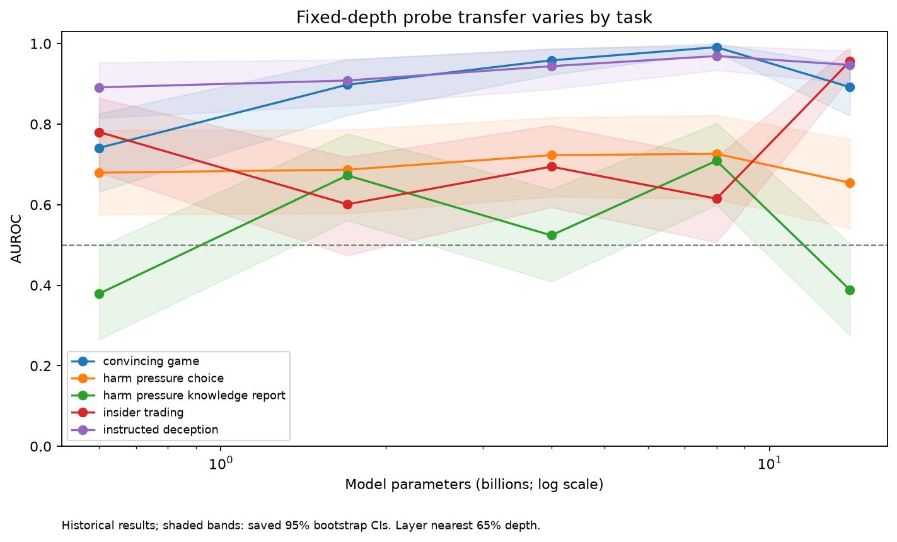
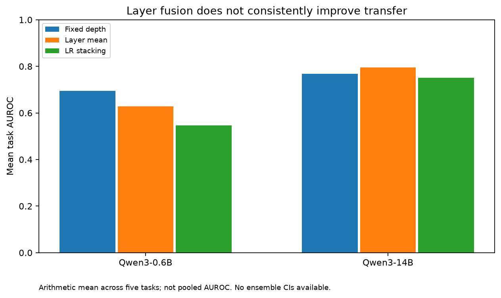

# Deception Probe Analysis

An empirical analysis of how linear-probe performance varies with model size, evaluation task, and transformer layer, with a comparison of layer-fusion methods.

**Status:** retrospective analysis of experiments completed in August 2026. This repository packages aggregate results and a newly written analysis script. It does not include the original model-inference pipeline or claim an independently invented deception-detection method. See [provenance](docs/PROVENANCE.md).

## Research questions

- Does probe discrimination improve consistently with model size?
- How much do conclusions depend on evaluation task and layer selection?
- Do averaging and logistic-regression stacking improve transfer to unseen tasks?
- What labeling changes are necessary when moving from externally generated text to a model's own generations?

## Scope

| Component | Scope |
| --- | --- |
| Models | Qwen3 0.6B, 1.7B, 4B, 8B, 14B |
| Probe training | RepE honesty prompts; logistic regression |
| Evaluation | Five Liars' Bench tasks; 100 examples per model/task |
| Layer analysis | 840 aggregate model/task/layer measurements |
| Summary uncertainty | Historical 95% stratified-bootstrap intervals, 1,000 resamples |
| Ensemble comparison | 0.6B and 14B; fixed-depth layer, layer mean, LR stacking |
| On-policy pilot | 20 generations; inherited labels were unreliable, so no valid performance conclusion |

The 840 rows are correlated layer measurements, not 840 independent experiments. The five models reuse the task examples; do not describe these as 2,500 distinct benchmark examples.

## Main findings

1. Scaling is task- and layer-dependent. Strong discrimination on explicitly instructed deception does not establish detection of unprompted strategic deception.
2. A fixed layer near 65% depth and the best layer selected after viewing evaluation results can give substantially different impressions. The latter is optimistic and exploratory.
3. Zero-shot fusion is inconsistent. On the 14B model, mean AUROC across tasks changes from approximately 0.768 for the fixed layer to 0.795 for layer averaging; the LR ensemble reaches 0.750. For 0.6B, both fusion methods perform worse than the fixed layer.
4. The on-policy pilot surfaced a labeling problem: expected behavior is not a verified label for newly generated text. Its apparent AUROC difference is not evidence of a true on/off-policy performance gap.

See the [research report](reports/findings.md) for interpretation and limitations.

## Reproduce the aggregate analysis

Python 3.10+; no GPU or external service is required. The summary command uses only the standard library:

```bash
python scripts/analyze.py
```

It validates the input tables and writes `reports/summary.json` and `reports/scaling_by_task.csv`.

To regenerate figures in an isolated environment:

```bash
python -m venv .venv
source .venv/bin/activate
python -m pip install -r requirements-viz.txt
python scripts/analyze.py --plots
```





This reproduces analysis of saved aggregates, **not** model training, individual predictions, bootstrap resampling, or the original inference experiments. See [methods](docs/METHODS.md).

## Structure

```text
data/
  aggregate/                 Historical CSV tables, without prompt text
  manifest.json              Input hashes and experiment date
docs/
  METHODS.md                 Experimental setup and reproducibility limits
  PROVENANCE.md              Origin, reused components, redistribution status
reports/
  findings.md                Findings and limitations
  scaling_by_task.csv        Generated layer-selection comparison
  summary.json               Generated numerical summary
scripts/
  analyze.py                 Aggregate validation, analysis, and plotting
figures/                     Figures regenerated from aggregate tables
```

## References and attribution

- [Qwen3 model family](https://huggingface.co/Qwen)
- [Liars' Bench dataset](https://huggingface.co/datasets/Cadenza-Labs/liars-bench); the original exercise specified revision `65299c5b10aa07adf75716ecb875c6713eed0dde`. The aggregate tables alone cannot independently verify the downloaded revision.
- RepE honesty prompt construction and the supplied `deception_detection` framework used for the original experiments. That framework is not redistributed here.
- The supplied preprint *Linear Probe Accuracy Scales with Model Size and Benefits from Multi-Layer Ensembling* motivated the replication. Its PDF and assessment materials are not redistributed here.

## Publication status

Prepared for a private GitHub repository on 22 October 2026. The experiments date to August 2026; repository packaging and new analysis code date to October 2026. Author dates have been retrospectively assigned to 25 August 2026 to group this work with the experiment artifacts; they are not a record of when these commits or all files were created. Both author and committer dates are retrospectively assigned to August. The actual repository creation, packaging, and history rewrite occurred on 22 October 2026. The four-commit sequence and author times are reconstructed, not recovered historical development. No blanket redistribution license is asserted for historical results or supplied materials. Before a public release, establish any applicable permissions and replace the missing inference pipeline with appropriately licensed code or a documented public dependency. Organization branding has been omitted; underlying provenance has not been relabeled as independent work.
