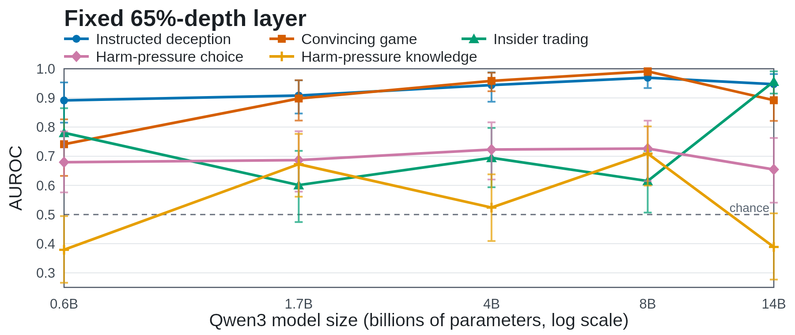
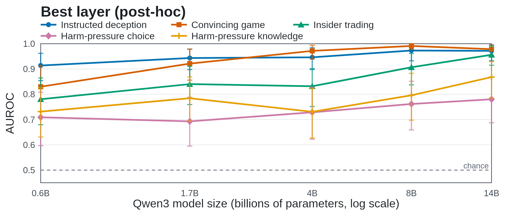
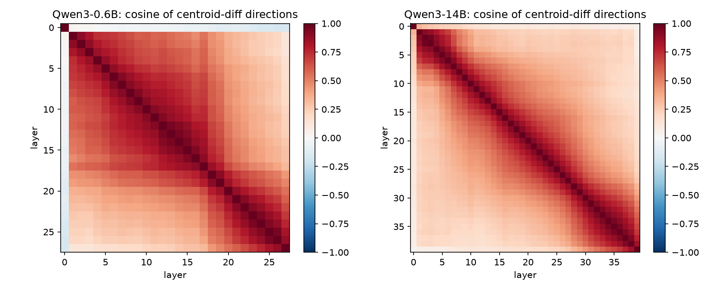

# Deception Probe Analysis

How reliably do linear deception probes transfer across model sizes, tasks, and transformer layers?

[Read the study](https://xenonnn4w.me/research/deception-probes) · [Findings](reports/findings.md) · [Methods](docs/METHODS.md)

Experiments completed in **August 2026** on an **NVIDIA A100 40GB**: five Qwen3 models (0.6B–14B), five Liars’ Bench tasks, and 100 examples per model/task. The same task examples are reused across models. This repository contains the saved aggregates, original figures, and aggregate-analysis code.

## Findings

- **Scaling depends on the task and layer.** Larger models do not improve consistently across every task.
- **Layer selection changes the story.** Selecting the best layer after seeing evaluation labels is exploratory, not a validated improvement.
- **Layer fusion is mixed.** For 14B, mean task AUROC is 0.768 at fixed depth, 0.795 with layer averaging, and 0.750 with LR stacking. Both fusion methods underperform the fixed layer at 0.6B.
- **New generations need new labels.** A 20-response pilot exposed disagreements with inherited labels; it does not support a reliable on-policy performance comparison.

## Original experiment figures

**Fixed-depth scaling.** Probes evaluated near 65% depth; error bars are the saved bootstrap intervals.



**Best observed layer.** Layers selected using evaluation performance; intervals do not correct for selection bias.



**Layer geometry.** Cosine similarity between centroid-difference directions, not fitted probe weights. The original image is preserved; the underlying centroid arrays are not included.



## Reproduce the aggregate analysis

Python 3.10+; no GPU required:

```bash
python scripts/analyze.py
```

This validates saved input hashes and writes summary tables to `reports/`. Optional redraws require `requirements-viz.txt`: run `python scripts/analyze.py --plots` to write them to `figures/generated/`, separately from the original images above.

The package does not reproduce model inference, probe training, or bootstrap resampling. These results concern labeled benchmark behavior, not demonstrated detection of real-world scheming. See [methods and references](docs/METHODS.md) and [provenance](docs/PROVENANCE.md) for the original exercise, contribution boundaries, and retrospective commit dates.
